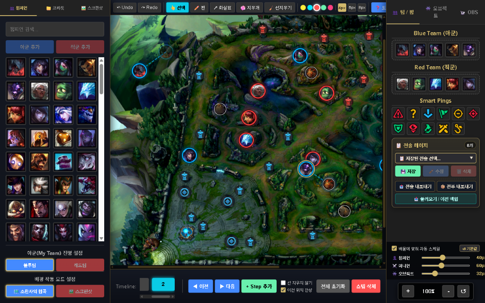
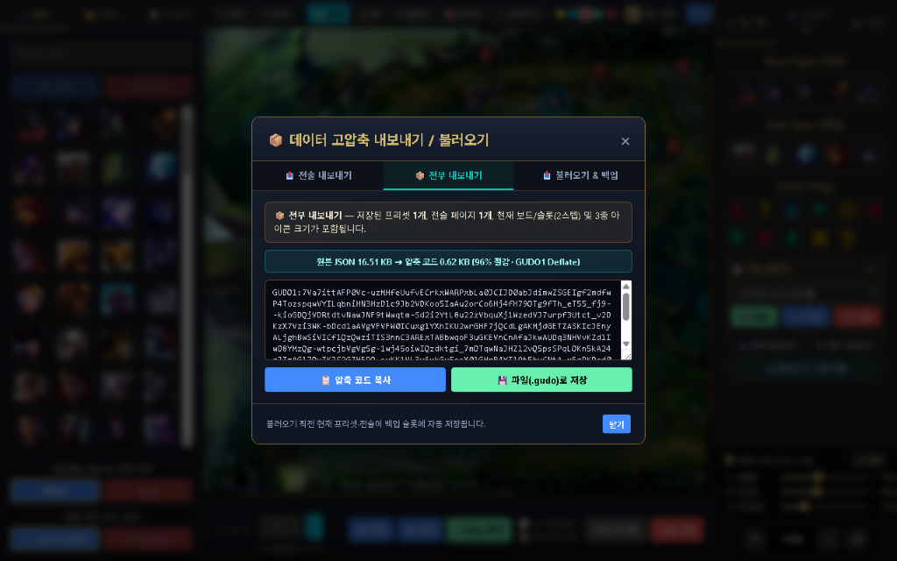
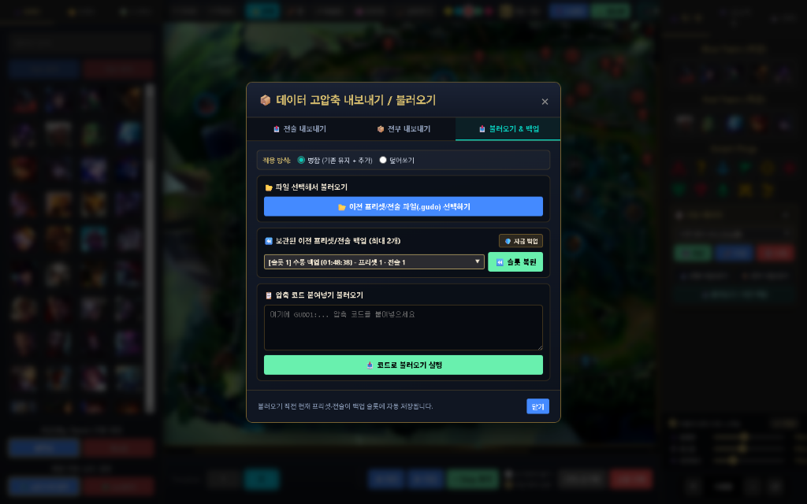
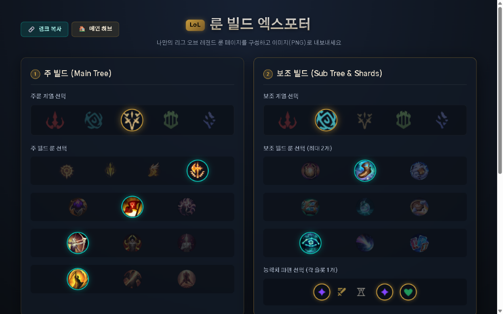
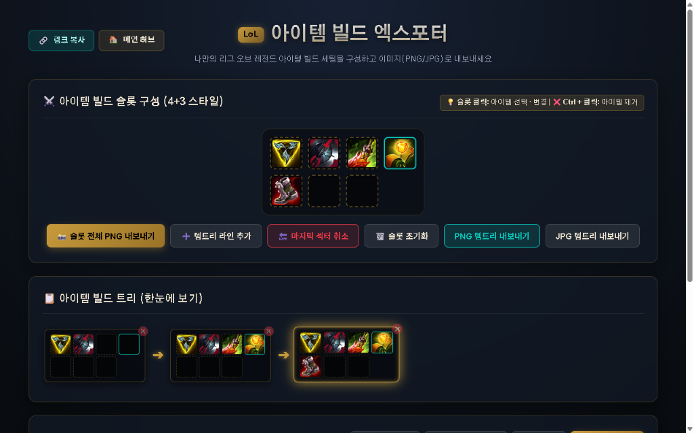
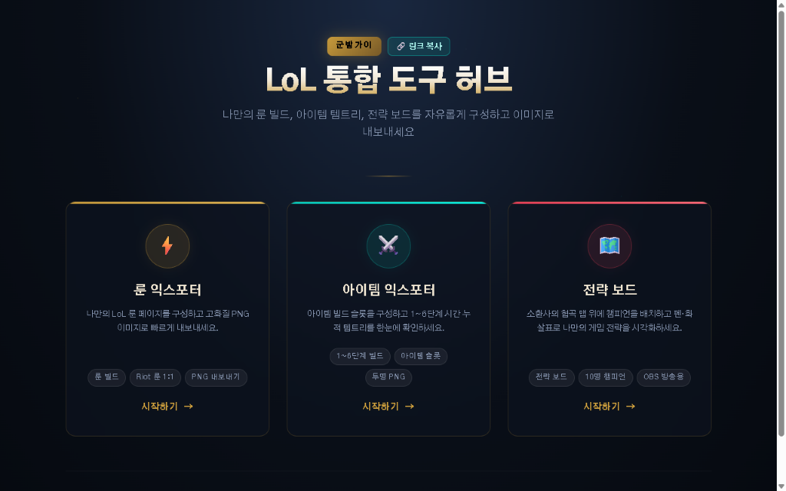

# 🛡️ GUDO — League of Legends 전략 보드 & 통합 도구

**LoL 전략 보드(Strategy Board)**를 중심으로, 팀 단위 포지셔닝·동선 브리핑·OBS 방송 송출·고압축 전술 공유를 브라우저에서 바로 처리할 수 있는 웹 기반 유틸리티 모음입니다.

- 🏠 **메인 허브**: [`index.html`](index.html)
- 🗺️ **전략 보드 (핵심 도구)**: [`strategy/index.html`](strategy/index.html) · [OBS 뷰어](strategy/obs.html)
- ⚡ **룬 빌드 익스포터**: [`rune/index.html`](rune/index.html)
- ⚔️ **아이템 빌드 익스포터**: [`rune/index.html#item`](rune/index.html#item)

> 각 페이지 상단 헤더의 **`🔗 링크 복사`** 버튼으로 개별 도구 주소를 바로 복사해 공유할 수 있습니다.

---

## 🗺️ 1. LoL 전략 보드 (Strategy Board — 핵심 도구)

소환사의 협곡(및 붙여넣은 게임 스크린샷) 위에 챔피언·정글 캠프·와드·핑·드로잉을 배치하고, 스텝별 타임라인과 OBS 오버레이로 전술을 설명하는 메인 애플리케이션입니다.


*소환사의 협곡 위 10인 챔피언 배치, 정글 캠프 일괄 젠, 2스텝 타임라인 및 이전 위치 잔상(점선 궤적)*

### 1) 챔피언 프리셋 & 초성 검색
- **실시간 Riot Data Dragon 연동**: 최신 패치 챔피언 목록을 로드하며, 한글 **초성 검색**(예: `ㄹㅅ`)을 지원합니다.
- **빠른 팀 슬롯 편성**: 챔피언 아이콘 **더블클릭 → 아군(Blue)**, **우클릭 → 적군(Red)** 슬롯(각 최대 5명)에 즉시 등록하거나 드래그로 맵에 배치합니다.
- **진영 일괄 드롭 & 팀 전환**: 좌·우 팀 프리셋 묶음(`#bluePresetList`, `#redPresetList`)을 한 번에 맵으로 드롭할 수 있으며, 좌측 하단에서 **아군(My Team) 블루/레드 진영**을 전환할 수 있습니다.
- **프리셋 저장소**: 현재 아군/적군 조합을 `localStorage`에 이름으로 저장하고 원클릭으로 다시 불러옵니다.

### 2) 협곡 오브젝트 · 정글 캠프 · 구조물 상태 관리
- **우측 오브젝트 탭**: 에픽 몬스터(바론, 드래곤, 전령, 공허 유충), 버프(블루/레드), 미니언, 와드(노랑/망원형/제어 와드/예언자의 렌즈/텔레포트), 스마트 핑을 드래그로 배치합니다.
- **🌲 캠프젠 (정글 캠프 일괄 배치)**: 저장된 정글 몬스터 좌표(커스텀 좌표 미저장 시 기본 좌표)를 현재 스텝에 한 번에 생성합니다.
- **처치·부재 토글**: 배치된 정글 캠프/오브젝트는 더블클릭으로 **반투명(처치/소모) 상태**를 토글하고, 포탑·억제기·넥서스 구조물은 파괴 상태로 전환할 수 있습니다.
- **우클릭 컨텍스트 메뉴**: 배치된 챔피언의 테두리 색상(블루/레드/흰색) 변경, 화살표 추가/제거, 삭제를 빠르게 수행합니다.

### 3) 드로잉 · 화살표 & 멀티 스텝 타임라인
- **4가지 조작 모드**: `👆 선택(1)`, `✏️ 펜(2)`, `↗ 화살표(3)`, `🧼 지우개(4)` + `🧹 선지우기(C)`
  - 펜 색상 5종 및 두께(`4px`, `6px`, `8px`) 조절 지원
  - **객체 귀속 화살표**와 **독립 화살표** 모두 지원하며, `이전 위치 잔상` 옵션 활성화 시 직전 스텝에서 이동한 챔피언의 원래 위치와 이동 궤적 점선을 함께 표시합니다.
- **멀티 스텝 타임라인**: `+ Step 추가`로 현재 배치를 다음 단계로 이어가며(`선 지우지 않기` 체크 가능), Undo/Redo(`Ctrl+Z` / `Ctrl+Shift+Z`, 최대 50단계)를 지원합니다.

### 4) 배경 작동 모드 & 3종 아이콘 크기 제어
- **협곡 맵 ↔ 스크린샷 모드**: 화면 어디서든 `Ctrl+V`로 클립보드 이미지를 붙여넣으면 자동으로 **스크린샷 모드**로 전환되어 배경에 적용(기본 구조물 레이어 자동 숨김)되며, 좌측 스크린샷 탭에서 관리합니다.
- **3종 아이콘 개별 크기 & 자동 스케일**: 우측 하단에서 **👤 챔피언 / ⚔️ 미니언 / 👾 오브젝트** 크기를 각각 슬라이더로 조절하고, 확대(Zoom In) 시 아이콘이 맵을 과도하게 가리지 않도록 비례 축소하는 `배율에 맞춰 자동 스케일` 옵션을 제공합니다.

### 5) 📦 3단계 고압축 내보내기 / 불러오기 (`GUDO1:`) & 2슬롯 백업
다른 사용자와 전술이나 전체 설정을 짧은 코드 또는 `.gudo` 파일로 주고받을 수 있도록 브라우저 내장 **`CompressionStream('deflate-raw')`** 기반 3단계 압축 코덱을 구현했습니다.

1. **에셋 사전 인덱싱 (`getAssetDict`)**: 반복되는 CommunityDragon / 정글 캠프 URL을 숫자 인덱스로 치환
2. **펜 획 델타 인코딩 & 튜플 패킹 (`encodeStrokePoints`, `packTimelineData`)**: 연속 좌표를 이전 점 기준 차분(`dx, dy`) 정수로 압축하고, 객체 타입별 최소 길이 배열 튜플로 직렬화 (`champ_<id>` 기본 UID는 `'$'` 단축 표기)
3. **Deflate + Base64URL (`GUDO1:` / 폴백 `GUDO0:`)**: 압축된 바이너리를 텍스트 코드로 변환 (`📋 압축 코드 복사` / `💾 파일(.gudo)로 저장`)

- **두 가지 내보내기 범위** (`배율에 맞춰 자동 스케일` 상단 `📤 내보내기` / `📥 불러오기`):
  - **📤 전술 내보내기**: 저장된 전술 페이지 전체 + 현재 보드 작업 상태
  - **📦 전부 내보내기**: 저장된 프리셋 + 전술 페이지 전체 + 현재 보드 + 3종 아이콘 크기 설정 + 커스텀 정글 캠프 좌표
- **불러오기(`📥 불러오기`) & 안전 장치**:
  - **병합(Merge) / 덮어쓰기(Overwrite)** 모드 선택 (기존 JSON 포맷 호환 지원)
  - 병합 시 정규화 레이아웃 시그니처(`getBoardLayoutSignature`) 기준으로 중복 전술·프리셋을 걸러내고, 미저장 `currentBoard`는 `가져온 전술 (...)` 항목으로 함께 보존
  - 로컬에 없는 스크린샷 ID가 포함된 경우 빈 화면 대신 `'map'` 모드로 안전 폴백
  - **2슬롯 롤링 백업 (`lol_strategy_backup_slots`)**: 불러오기 및 슬롯 복원 직전 현재 작업 상태를 `v: 1` 압축 백업 슬롯(최대 2개)에 자동 보관

| `📦 전부 내보내기` (`GUDO1` 압축 코드 · 96% 절감) | `📥 불러오기 & 2슬롯 백업` |
| :---: | :---: |
|  |  |

### 6) 📹 OBS 방송 송출 & 📱 모바일/튜토리얼
- **OBS 실시간 송출 ([`strategy/obs.html`](strategy/obs.html))**: `BroadcastChannel('lol_board_obs')`를 통해 맵, 배치된 객체·화살표·펜 선, 줌/스크롤 뷰포트, 아이콘 크기 및 마우스 커서 좌표를 방송용 오버레이 창으로 실시간 전송합니다.
- **모바일 터치 제스처**: 1손가락 드래그(도구별 그리기/패닝·오브젝트 이동), 1손가락 탭/더블탭, 2손가락 핀치 줌·패닝 및 반응형 햄버거 메뉴/슬라이딩 드로어를 지원합니다.
- **🎓 단계별 인터랙티브 튜토리얼**: 상단 `🎓 튜토리얼` 버튼으로 주요 기능을 순서대로 안내받을 수 있습니다.

### ⌨️ 전략 보드 주요 단축키

| 단축키 | 동작 |
| :--- | :--- |
| `1` / `2` / `3` / `4` | 선택 / 펜 / 화살표 / 지우개 도구 전환 |
| `C` | 챔피언·오브젝트를 유지하고 현재 스텝의 선과 화살표만 삭제 |
| `←` / `→` | 이전 / 다음 타임라인 스텝 이동 |
| `Del` / `Backspace` | 선택된 객체 삭제 |
| `Ctrl + Z` | 실행 취소 (Undo) |
| `Ctrl + Shift + Z` / `Ctrl + Y` | 다시 실행 (Redo) |
| `Ctrl + V` | 클립보드 이미지 붙여넣기 (스크린샷 배경 적용) |
| `Esc` | 열린 모달(도움말 / 내보내기·불러오기 / 튜토리얼) 닫기 |

---

## ⚡ 2. 부가 도구: 룬 · 아이템 익스포터 & 메인 허브

메인 허브([`index.html`](index.html))에서 진입하는 보조 유틸리티 모음([`rune/index.html`](rune/index.html))입니다.

### ⚡ 룬 빌드 익스포터 (`rune/index.html`)
- Riot 공식 Data Dragon 룬 데이터 및 CommunityDragon 능력치 파편(총 9개 슬롯) 1:1 선택 지원
- 제목/챔피언 커스텀 텍스트(크기·색상), 상단 커스텀 로고(`Ctrl+V` 붙여넣기 및 파일 업로드), 배경 투명도·모서리 둥글기 및 세부 레이아웃 모달(`canvasScale`, 간격, 룬 크기, 패딩) 실시간 미리보기
- **전체 룬 카드 / 주 빌드 / 보조 빌드 / 선택 룬만 강조(투명 배경)** PNG 내보내기



### ⚔️ 아이템 빌드 익스포터 (`rune/index.html#item`)
- **4+3 슬롯**(메인 슬롯 6칸 + 4번 와드/장신구 전용 슬롯) 기반 아이템 선택 및 초성/이름 검색
- **1~6단계 시간 누적 템트리 라인** 구성 후 PNG / JPG 이미지 내보내기
- 커스텀 아이템 프리셋 생성·편집 및 텍스트 코드/파일(`.txt`, `.json`) 내보내기·불러오기



### 🏠 통합 메인 허브 (`index.html`)
- 룬 익스포터, 아이템 익스포터(`#item`), 전략 보드로 바로 이동할 수 있는 통합 랜딩 페이지



---

## 📁 프로젝트 구조

```text
gudo/
├── index.html                  # GUDO 메인 허브 (도구 진입 및 링크 복사)
├── LICENSE                     # MIT 라이선스 및 Riot Games / 서드파티 고지
├── README.md
├── docs/
│   ├── adr/                    # 아키텍처 결정 기록 및 엔진 트러블슈팅 문서
│   └── screenshots/            # README 안내용 실제 실행 화면 스크린샷 (6종)
├── css/
│   └── hub.css                 # 메인 허브 스타일
├── js/
│   ├── mainHub.js              # 허브 초기화 및 링크 복사 제어
│   └── fowParser.js            # FOW 매치 파싱 유틸리티
├── strategy/                   # 🗺️ LoL 전략 보드 (핵심 도구)
│   ├── index.html              # 전략 보드 메인 UI & 내보내기/불러오기 모달
│   ├── obs.html                # OBS 브라우저 소스용 오버레이 뷰어
│   ├── css/index.css
│   ├── images/                 # 협곡 맵, 미니언, 정글 캠프 로컬 이미지
│   └── js/
│       ├── constants.js        # 핑·오브젝트·와드·아이콘 상수 정의
│       ├── app.js              # 보드 엔진, GUDO1 코덱, 2슬롯 백업, 터치·튜토리얼
│       └── obs.js              # OBS 오버레이 수신 및 렌더링 엔진
└── rune/                       # ⚡ 룬 & ⚔️ 아이템 익스포터 (부가 도구)
    ├── index.html
    ├── css/style.css
    └── js/
        ├── config.js           # CDN 경로, 레이아웃 기본값, 파편 정의
        ├── storage.js          # localStorage 상태 저장/복원
        ├── canvasEngine.js     # 룬 카드 HTML5 Canvas 렌더링 엔진
        ├── itemEngine.js       # 4+3 아이템 슬롯, 템트리, 커스텀 프리셋 엔진
        ├── app.js              # 룬/아이템 UI 이벤트, 탭 전환, 링크 복사
        └── logger.js
```

---

## ⚖️ 라이선스 및 저작권 안내

- 본 프로젝트의 소스 코드는 [**MIT License**](LICENSE)에 따라 배포됩니다.
- 본 도구에 사용된 리그 오브 레전드 챔피언·아이템·룬·맵 관련 이미지 및 CDN 데이터는 **Riot Games, Inc.**의 자산이며, Riot Games Legal Jibber Jabber 정책을 따릅니다.
- **html2canvas** (MIT License) 및 Google Fonts **Gothic A1 · Outfit** (SIL Open Font License 1.1)의 상세 고지는 [`LICENSE`](LICENSE) 파일을 참고하세요.

> *GUDO isn't endorsed by Riot Games and doesn't reflect the views or opinions of Riot Games or anyone officially involved in producing or managing Riot Games properties. Riot Games, and all associated properties are trademarks or registered trademarks of Riot Games, Inc.*
